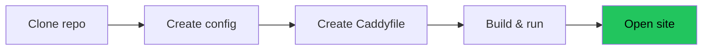
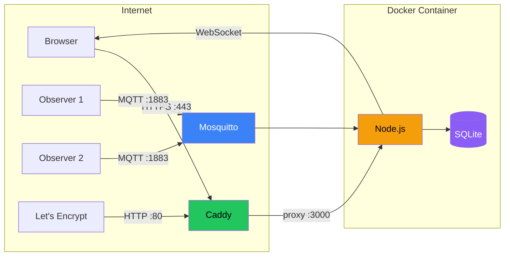
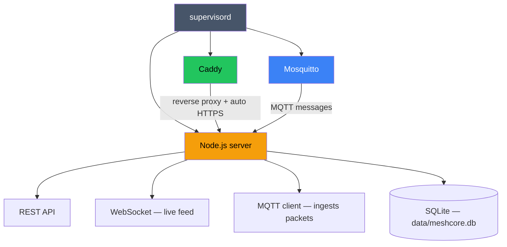
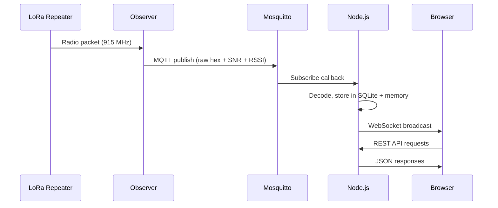

# Deploying CoreScope

Get CoreScope running with automatic HTTPS on your own server.

## Table of Contents

- [What You'll End Up With](#what-youll-end-up-with)
- [What You Need Before Starting](#what-you-need-before-starting)
- [Installing Docker](#installing-docker)
- [Quick Start](#quick-start)
- [Connecting an Observer](#connecting-an-observer)
- [HTTPS Options](#https-options)
- [MQTT Security](#mqtt-security)
- [Database Backups](#database-backups)
- [Updating](#updating)
- [Customization](#customization)
- [Troubleshooting](#troubleshooting)
- [Architecture Overview](#architecture-overview)

## What You'll End Up With

- CoreScope running at `https://your-domain.com`
- Automatic HTTPS certificates (via Let's Encrypt + Caddy)
- Built-in MQTT broker for receiving packets from observers
- SQLite database for packet storage (auto-created)
- Everything in a single Docker container

## What You Need Before Starting

### A server
A computer that's always on and connected to the internet:
- **Cloud VM** — DigitalOcean, Linode, Vultr, AWS, Azure, etc. A $5-6/month VPS works. Pick **Ubuntu 22.04 or 24.04**.
- **Raspberry Pi** — Works, just slower to build.
- **Home PC/laptop** — Works if your ISP doesn't block ports 80/443 (many residential ISPs do).

You'll need **SSH access** to your server. Cloud providers give you instructions when you create the VM.

### A domain name
A domain (like `analyzer.example.com`) pointed at your server's IP:
- Buy one (~$10/year) from Namecheap, Cloudflare, etc.
- Or use a free subdomain from [DuckDNS](https://www.duckdns.org/) or [FreeDNS](https://freedns.afraid.org/)

After getting a domain, create an **A record** pointing to your server's IP address. Your domain provider's dashboard will have a "DNS" section for this.

**Important:** DNS must be configured and propagated *before* you start the container. Caddy will try to provision certificates on startup and fail if the domain doesn't resolve. Verify with `dig analyzer.example.com` — it should show your server's IP.

### Open ports
Your server's firewall must allow:
- **Port 80** — needed for HTTPS certificate provisioning (Let's Encrypt ACME challenge)
- **Port 443** — HTTPS traffic

Cloud providers: find "Security Groups" or "Firewall" in the dashboard, add inbound rules for TCP 80 and 443 from 0.0.0.0/0.

Ubuntu firewall:
```bash
sudo ufw allow 80/tcp
sudo ufw allow 443/tcp
```

## Installing Docker

Docker packages an app and all its dependencies into a container — an isolated environment with everything it needs to run. You don't install Node.js, Mosquitto, or Caddy separately; they're all included in the container.

SSH into your server and run:

```bash
# Install Docker
curl -fsSL https://get.docker.com | sh

# Allow your user to run Docker without sudo
sudo usermod -aG docker $USER
```

**Log out and SSH back in** (the group change needs a new session), then verify:

```bash
docker --version
# Should print: Docker version 24.x.x or newer
```

## Quick Start

The easiest way — use the management script:

```bash
git clone https://github.com/Kpa-clawbot/corescope.git
cd corescope
./manage.sh setup
```

It walks you through everything: checks Docker, creates config, asks for your domain, checks DNS, builds, and starts.

After setup, manage with:
```bash
./manage.sh status       # Check if everything's running
./manage.sh logs         # View logs
./manage.sh backup       # Backup the database
./manage.sh update       # Pull latest + rebuild + restart
./manage.sh mqtt-test    # Check if MQTT data is flowing
./manage.sh help         # All commands
```

### Manual setup



### 1. Download the code

```bash
git clone https://github.com/Kpa-clawbot/corescope.git
cd corescope
```

### 2. Create your config

```bash
cp config.example.json config.json
nano config.json
```

Change the `apiKey` to any random string. The rest of the defaults work out of the box.

```jsonc
{
  "apiKey": "change-me-to-something-random",
  ...
}
```

Save: `Ctrl+O`, `Enter`, `Ctrl+X`.

### 3. Set up your domain for HTTPS

```bash
mkdir -p caddy-config
nano caddy-config/Caddyfile
```

Enter your domain (replace `analyzer.example.com` with yours):

```
analyzer.example.com {
    reverse_proxy localhost:3000
}
```

Save and close. Caddy handles certificates, renewals, and HTTP→HTTPS redirects automatically.

### 4. Build and run

```bash
docker build -t corescope .

docker run -d \
  --name corescope \
  --restart unless-stopped \
  -p 80:80 \
  -p 443:443 \
  -v $(pwd)/config.json:/app/config.json:ro \
  -v $(pwd)/caddy-config/Caddyfile:/etc/caddy/Caddyfile:ro \
  -v meshcore-data:/app/data \
  -v caddy-data:/data/caddy \
  corescope
```

What each flag does:
| Flag | Purpose |
|------|---------|
| `-d` | Run in background |
| `--restart unless-stopped` | Auto-restart on crash or reboot |
| `-p 80:80 -p 443:443` | Expose web ports |
| `-v .../config.json:...ro` | Your config (read-only) |
| `-v .../Caddyfile:...` | Your domain config |
| `-v meshcore-data:/app/data` | Database storage (persists across restarts) |
| `-v caddy-data:/data/caddy` | HTTPS certificate storage |

### 5. Verify

Open `https://your-domain.com`. You should see the analyzer home page.

Check the logs:
```bash
docker logs corescope
```

#### Parameters

| Parameter | Required | Description |
|-----------|----------|-------------|
| `-p 80:80` | Yes | HTTP web UI |
| `-p 443:443` | No | HTTPS (only if using built-in Caddy with a domain) |
| `-p 1883:1883` | No | MQTT broker (expose if external gateways connect directly) |
| `-v /your/data:/app/data` | Yes | Persistent data: SQLite DB, config.json, theme.json |
| `-v /your/Caddyfile:/etc/caddy/Caddyfile:ro` | No | Custom Caddyfile for HTTPS |
| `-v /your/caddy-data:/data/caddy` | No | Caddy TLS certificate storage |
| `-e DISABLE_MOSQUITTO=true` | No | Skip the internal Mosquitto broker (use your own) |
| `-e DISABLE_CADDY=true` | No | Skip the built-in Caddy reverse proxy |
| `-e MQTT_BROKER=mqtt://host:1883` | No | Override MQTT broker URL |
| `-e RUN_AS_UID=1000` | No | Run the Go services as this uid instead of root — see [Running the Go services unprivileged](#running-the-go-services-unprivileged) |
| `-e RUN_AS_GID=1000` | No | Group for `RUN_AS_UID` (defaults to it) |

#### `/app/data/.env` convenience file

Instead of passing `-e` flags, you can drop a `.env` file in your data volume:

```bash
# /your/data/.env
DISABLE_MOSQUITTO=true
DISABLE_CADDY=true
MQTT_BROKER=mqtt://my-broker:1883
```

The container runs its own MQTT broker (Mosquitto) internally — that `localhost:1883` connection is inside the container, not exposed to the internet.

Two exceptions, both because the entrypoint runs this file as root from a
directory the Go services can write once they run unprivileged:

- `RUN_AS_UID` and `RUN_AS_GID` are never taken from `.env`. Set them with
  `-e` or in compose's `environment:`.
- With `RUN_AS_UID` set, `.env` is read only if it is owned by root and
  writable by no one else (`sudo chown root:root .env && sudo chmod 644 .env`).
  Otherwise the log says it was skipped, and why. "Owned by root" means uid 0
  inside the container. With rootless Docker or a user-namespace remap
  (`userns-remap`), host root is not that uid: look at the owner the container
  reports (`docker exec <container> stat -c '%u' /app/data/.env`) and give the host
  file whichever owner id maps to container uid 0.

### Docker Compose (legacy alternative)

The analyzer receives packets from observers via MQTT.

### Option A: Use a public broker

Add a remote broker to `mqttSources` in your `config.json`:

```json
{
  "name": "public-broker",
  "broker": "mqtts://mqtt.lincomatic.com:8883",
  "username": "your-username",
  "password": "your-password",
  "rejectUnauthorized": false,
  "topics": ["meshcore/SJC/#", "meshcore/SFO/#"]
}
```

Restart: `docker restart corescope`

### Option B: Run your own observer

You need a MeshCore repeater connected via USB or BLE to a computer running [meshcoretomqtt](https://github.com/Cisien/meshcoretomqtt). Point it at your analyzer's MQTT broker.

⚠️ If your observer is remote (not on the same machine), you'll need to expose port 1883. **Read the MQTT Security section first.**

## HTTPS Options

### Automatic (recommended) — Caddy + Let's Encrypt

This is what the Quick Start sets up. Caddy handles everything. Requirements:
- Domain pointed at your server
- Ports 80 + 443 open
- No other web server (Apache, nginx) running on those ports

### Bring your own certificate

If you already have a certificate (from Cloudflare, your organization, etc.), tell Caddy to use it instead of Let's Encrypt:

```
analyzer.example.com {
    tls /path/to/cert.pem /path/to/key.pem
    reverse_proxy localhost:3000
}
```

Mount the cert files into the container:
```bash
docker run ... \
  -v /path/to/cert.pem:/certs/cert.pem:ro \
  -v /path/to/key.pem:/certs/key.pem:ro \
  ...
```

And update the Caddyfile paths to `/certs/cert.pem` and `/certs/key.pem`.

### Running the Go services unprivileged

`corescope-server` and `corescope-ingestor` can run as a normal user instead of
root, so that a code-execution bug in either one does not land as root in a
container that has your data directory and `config.json` mounted. `supervisord`
itself stays root, because mosquitto and caddy still need to bind their ports.

It is opt-in, with `RUN_AS_UID`:

| `RUN_AS_UID` | Services run as |
|--------------|-----------------|
| unset (the default) | root — as in earlier releases |
| set | `RUN_AS_UID` / `RUN_AS_GID` |

Nothing about an upgrade changes until you set it: the container does not pick a
uid for you, and does not change the owner of anything on your host. That is
deliberate rather than cautious. Every release before this one ran as root, so
the `meshcore.db` in your data directory — with its `-wal` and `-shm`, `users.db`
and the backups beside them — is root-owned. Switching user without also handing
those files over leaves the services unable to write the database, so the switch
has to be something you ask for.

**To turn it on**, pick the uid you want and restart. Setting `RUN_AS_UID` is
taken as permission to `chown` the data directory, and what an earlier root-run
container left in it, to that uid. This happens at every start, so a file
created there later as root (with `docker exec`, say) is handed over at the
next restart:

```bash
docker run -d --name corescope \
  -e RUN_AS_UID=1000 -e RUN_AS_GID=1000 \
  -v /your/data:/app/data \
  ... # same flags as before
  ghcr.io/kpa-clawbot/corescope:latest
```

Check which user it picked:

```bash
docker logs corescope 2>&1 | grep '\[entrypoint\] Go services run as'
# [entrypoint] Go services run as corescope (uid=1000 gid=1000)
```

If you would rather the container never `chown` anything, do the hand-over
yourself first. Then there is nothing left for it to change:

```bash
docker stop corescope
sudo chown -R 1000:1000 /your/data     # uid of your own account is usually 1000
docker start corescope                 # with RUN_AS_UID=1000 set as above
```

To go back, unset `RUN_AS_UID` and `chown -R root:root /your/data`.

Notes:

- `RUN_AS_GID` defaults to `RUN_AS_UID` when omitted. `RUN_AS_UID=0` is the
  same as leaving it unset.
- If the uid already belongs to another account inside the image (`caddy` is
  uid 100, `mosquitto` 101), that account is used as it is, keeping its own
  group, and the log says so. Pick a different uid if you need `RUN_AS_GID`
  honoured.
- With `RUN_AS_UID` set to a uid the container cannot use, startup fails rather
  than quietly falling back to root.
- What the hand-over leaves alone: anything mounted into the data directory on
  its own, such as `-v ./config.json:/app/data/config.json:ro`, which keeps the
  owner it has on your host (make sure the uid can read it), and `.env` (see
  above). Each mount it skips is named in the log.
- If the hand-over cannot change a file, for example on NFS with
  `root_squash`, the log says how many and which. Fix their owner on the host.
- `/app` stays root's. The services write only to the data directory and
  `/tmp`.
- A fresh install is root-owned and so starts as root, like any other. Set
  `RUN_AS_UID` from the first run to avoid a hand-over later.

The uid selection lives in `docker/select-service-user.sh`, with its branches
covered by `docker/test-select-service-user.sh`.

---

If you can't open ports 80/443 (residential ISP, restrictive firewall), use a [Cloudflare Tunnel](https://developers.cloudflare.com/cloudflare-one/connections/connect-networks/). It creates an outbound connection from your server to Cloudflare — no inbound ports needed. Your Caddyfile becomes:

```
:80 {
    reverse_proxy localhost:3000
}
```

And Cloudflare handles HTTPS at the edge.

### Behind an existing reverse proxy (nginx, Traefik, etc.)

If you already run a reverse proxy, skip Caddy entirely and proxy directly to the Node.js port:

```bash
docker run -d \
  --name corescope \
  --restart unless-stopped \
  -p 3000:3000 \
  -v $(pwd)/config.json:/app/config.json:ro \
  -v meshcore-data:/app/data \
  corescope
```

Then configure your existing proxy to forward traffic to `localhost:3000`.

### HTTP only (development / local network)

For local testing or a LAN-only setup, use the default Caddyfile that ships in the image (serves on port 80, no HTTPS):

```bash
docker run -d \
  --name corescope \
  --restart unless-stopped \
  -p 80:80 \
  -v $(pwd)/config.json:/app/config.json:ro \
  -v meshcore-data:/app/data \
  corescope
```

## MQTT Security

The container runs Mosquitto on port 1883 with **anonymous access by default**. This is safe as long as the port isn't exposed outside the container.

The Quick Start docker run command above does **not** expose port 1883. Only add `-p 1883:1883` if you need remote observers to connect directly.

#### CARTO now requires an API key

CARTO's raster basemaps (`carto-dark`, `carto-light`, `carto-voyager`,
`carto-voyager-dark`, `positron-dark`) require an API key. Without one, tiles
are still returned with a **200 status** but every one of them is stamped
`API KEY REQUIRED` — so nothing errors, no healthcheck fires, and the map just
quietly looks broken.

Get a free key at <https://carto.com/basemaps/apikey> — no CARTO account, no
credit card, emailed back immediately, 5 million tile requests per calendar
month across raster and vector. Then set it as `key`:

```json
"map": {
  "tiles": {
    "providers": {
      "carto": { "enabled": true, "key": "YOUR_CARTO_KEY" }
    }
  }
}
```

Notes:

- The query parameter is `key`. **`api_key` is silently ignored** and still
  serves the watermarked tile.
- The key is sent to the browser, so treat it as public. CARTO asks for a domain
  when the key is issued, but whether that restriction is enforced on every
  request has not been verified here. Assume anyone can read the key from
  devtools and spend your quota. The 5M/month fair-use ceiling makes that
  low-impact for most deployments, but it is worth knowing.
- A wrong or expired key fails the same silent way as no key at all. Verify by
  **looking at a tile**, not by checking for a 200.
- CARTO has said it is considering freezing data updates to the raster
  basemaps. If you would rather not depend on them, set
  `"carto": { "enabled": false }` and use another provider — `esri` needs no
  key at all, and `osm`/`stamen` accept their own tokens.

---

**Option 1: Firewall** — Only allow specific IPs:
```bash
sudo ufw allow from 203.0.113.10 to any port 1883   # Your observer's IP
```

**Option 2: Add authentication** — Edit `docker/mosquitto.conf` before building:
```
allow_anonymous false
password_file /etc/mosquitto/passwd
```
After starting the container, create users:
```bash
docker exec -it corescope mosquitto_passwd -c /etc/mosquitto/passwd myuser
```

**Option 3: Use TLS** — For production, configure Mosquitto with TLS certificates. See the [Mosquitto docs](https://mosquitto.org/man/mosquitto-conf-5.html).

### Recommended approach for remote observers

Don't expose 1883 at all. Instead, have your observers publish to a shared public MQTT broker (like lincomatic's), and configure your analyzer to subscribe to that broker in `mqttSources`. The analyzer makes an outbound connection — no inbound ports needed.

## Database Backups

Packet data is stored in `meshcore.db` inside the data volume.

**Using manage.sh (easiest):**

```bash
./manage.sh backup                          # Saves to ./backups/corescope-TIMESTAMP/
./manage.sh backup ~/my-backup.db           # Custom path
./manage.sh restore ./backups/some-file.db  # Restore (backs up current DB first)
```

**Local directory mount (recommended):**

If you used `-v ./analyzer-data:/app/data` instead of a Docker volume, the database is just `./analyzer-data/meshcore.db` — back it up however you like.

**Automated daily backup (cron):**

```bash
crontab -e
# Add:
0 3 * * * cd /path/to/corescope && ./manage.sh backup
```

## Updating

```bash
./manage.sh update
```

Pulls latest code, rebuilds the image, restarts the container. Data is preserved.

Data is preserved in the Docker volumes.

**Tip:** Save your `docker run` command in a script (`run.sh`) so you don't have to remember all the flags.

## Customization

### Branding

In `config.json`:

```json
{
  "mqttSources": [
    {
      "name": "local",
      "broker": "mqtt://localhost:1883",
      "topics": ["meshcore/#"]
    },
    {
      "name": "remote",
      "broker": "mqtts://remote-broker:8883",
      "username": "reader",
      "password": "secret",
      "topics": ["meshcore/+/+/packets"]
    }
  ]
}
```

### MQTT topic format

MeshCore gateways typically publish to `meshcore/<gateway>/<region>/packets`. The default subscription `meshcore/#` catches all of them.

---

## TLS / HTTPS

### Option 1: External reverse proxy (recommended)

Run CoreScope behind nginx, Traefik, or Cloudflare Tunnel for TLS termination:

```nginx
# nginx example
server {
    listen 443 ssl;
    server_name corescope.example.com;

    ssl_certificate /etc/ssl/certs/corescope.pem;
    ssl_certificate_key /etc/ssl/private/corescope.key;

    location / {
        proxy_pass http://localhost:80;
        proxy_http_version 1.1;
        proxy_set_header Upgrade $http_upgrade;
        proxy_set_header Connection "upgrade";
        proxy_set_header Host $host;
    }
}
```

The `Upgrade` and `Connection` headers are required for WebSocket support.

### Option 2: Built-in Caddy (auto-TLS)

The container includes Caddy for automatic Let's Encrypt certificates:

1. Create a Caddyfile:
   ```
   corescope.example.com {
     reverse_proxy localhost:3000
   }
   ```

2. Mount it and expose TLS ports:
   ```bash
   docker run -d --name corescope \
     -p 80:80 -p 443:443 \
     -v corescope-data:/app/data \
     -v caddy-certs:/data/caddy \
     -v ./Caddyfile:/etc/caddy/Caddyfile:ro \
     ghcr.io/kpa-clawbot/corescope:latest
   ```

Caddy handles certificate issuance and renewal automatically.

---

## API Documentation

CoreScope auto-generates an OpenAPI 3.0 specification from its route definitions. The spec is always in sync with the running server — no manual maintenance required.

### Endpoints

| URL | Description |
|-----|-------------|
| `/api/spec` | OpenAPI 3.0 JSON schema — machine-readable API definition |
| `/api/docs` | Interactive Swagger UI — browse and test all 40+ endpoints |

### Usage

**Browse the API interactively:**
```
http://your-instance/api/docs
```

**Fetch the spec programmatically:**
```bash
curl http://your-instance/api/spec | jq .
```

**For bot/integration developers:** The spec includes all request parameters, response schemas, and example values. Import it into Postman, Insomnia, or any OpenAPI-compatible tool.

### Public instance
The live instance at [analyzer.00id.net](https://analyzer.00id.net) has all API endpoints publicly accessible:
- Spec: [analyzer.00id.net/api/spec](https://analyzer.00id.net/api/spec)
- Docs: [analyzer.00id.net/api/docs](https://analyzer.00id.net/api/docs)

---

## Behind a CDN (Cloudflare, Fastly)

If you front CoreScope with a CDN — Cloudflare, Fastly, Akamai, or
similar — you **must** configure the CDN to bypass cache for `/api/*`.
The server emits `Cache-Control: no-store` on every API response
(see #1551), but Cloudflare's zone-level Cache Rules and legacy Page
Rules can override origin headers. When that happens, observers, packets,
stats and other API responses get cached at the edge for minutes to hours,
producing observer-flap, stale dashboards and inconsistent state across
viewers.

### 1. Verify whether your CDN is caching `/api/*`

From **outside** the CDN (a different network than your origin), run:

```sh
curl -sI 'https://<your-domain>/api/observers' | grep -iE 'cf-cache|age|cache-control'
```

Healthy output (cache is bypassed):

```
cache-control: no-store
cf-cache-status: BYPASS
age: 0
```

Unhealthy output (CDN is caching despite `no-store`):

```
cache-control: no-store
cf-cache-status: HIT
age: 4732
```

`HIT` or `age > 0` means an intermediary is serving cached JSON. Fix it
before relying on the dashboard.

You can also run the bundled helper, which exits non-zero with a precise
diagnostic when caching is detected:

```sh
scripts/check-cdn-bypass.sh https://<your-domain>
```

### 2. Cloudflare: add a Cache Rule (recommended)

Cloudflare Dashboard → your zone → **Caching → Cache Rules → Create rule**:

- **When incoming requests match:** Field = `URI Path`, Operator = `starts with`, Value = `/api/`
- **Then:** Cache eligibility → **Bypass cache**

Save and deploy. Re-run the curl above; you should now see
`cf-cache-status: BYPASS`.

Legacy Page Rules equivalent (if your zone has no Cache Rules):

- URL pattern: `*your-domain*/api/*`
- Setting: **Cache Level → Bypass**

### 3. Fastly / other CDNs

Apply the equivalent bypass-cache rule for the `/api/` path prefix.
The key invariant is: any response from `/api/*` must reach the
browser uncached (no shared-cache HIT, no positive `Age` header).

### 4. Re-verify

After applying the rule, run step 1's curl from outside the CDN again
and confirm `cf-cache-status: BYPASS` (or absence of HIT) and `age: 0`.

### 5. Watch the server log

The server logs a one-shot warning at the first request bearing a
CDN-specific header (`CF-Connecting-IP`, `CF-Ray`, `Fastly-Client-IP`,
or `True-Client-IP`):

Generic reverse-proxy headers (`X-Forwarded-For`, `X-Real-IP`) are
deliberately NOT used as the signal — every nginx/Caddy/Traefik/k8s
deploy sets them, so they'd produce false positives on every
reverse-proxied install.

```
[security] WARNING: detected request via CDN (CF-Ray header present).
Ensure /api/* is bypassed in your CDN config — see docs/deployment-behind-cdn.md.
Cached API responses cause observer-flap and incorrect dashboards.
```

This is informational — the request is not blocked. Treat it as a
prompt to run the verification curl above. The warning logs at most
once per process boot, regardless of how many CDN-fronted requests
arrive.

### Why this can't be fixed server-side

CDN cache policy is operator-controlled. The application emits the
most conservative cache header it can (`Cache-Control: no-store`),
but Cloudflare Cache Rules / Page Rules have higher precedence than
origin headers in many zone configurations. The only durable fix is
the operator-side bypass rule.

---

## Monitoring & Health Checks

### Docker health check

The container includes a built-in health check that hits `/api/stats`:

```bash
docker inspect --format='{{.State.Health.Status}}' corescope
```

Docker reports `healthy` or `unhealthy` automatically. The check runs every 30 seconds.

### Manual health check

```bash
curl -f http://localhost/api/stats
```

Returns JSON with packet counts, node counts, and version info:

```json
{
  "totalPackets": 56234,
  "totalNodes": 142,
  "totalObservers": 12,
  "packetsLastHour": 830,
  "packetsLast24h": 19644,
  "engine": "go",
  "version": "v3.4.1"
}
```

### Log monitoring

```bash
# All logs
docker compose logs -f

# Server only
docker compose logs -f | grep '\[server\]'

# Ingestor only
docker compose logs -f | grep '\[ingestor\]'
```

### Resource monitoring

```bash
docker stats corescope
```

---

## Backup & Restore

### Backup

Use **`GET /api/backup`** for the telemetry database. It uses SQLite's
[`VACUUM INTO`](https://www.sqlite.org/lang_vacuum.html) to produce a consistent
snapshot while the ingestor is running, including committed data in the WAL.
Do not copy the live `meshcore.db` file: a checkpoint followed by a file copy
also races new writes. Allow room for a full snapshot in the server's temporary
directory and at the download destination; large snapshots cost CPU and disk I/O.

When accounts are enabled, sign in as an administrator and open `/api/backup`
on the same site to download a snapshot. For command-line or scheduled backups,
configure a strong `apiKey` in `config.json` (at least 16 characters). Create a
private header file, `~/.config/corescope/backup.header`, containing one line:
`X-API-Key: <your configured key>`. Set its permissions to `600`; keep the key out
of shell history, URLs, and scripts checked into Git.

On the backup host, install `curl` and the `sqlite3` CLI. Replace the example
HTTPS origin below with your instance. The download is published as a `.db`
only after it is complete, nonempty, and passes SQLite's consistency check:

```bash
(
  set -eu
  umask 077
  backup_dir="$HOME/corescope-backups"
  mkdir -p "$backup_dir"
  tmp=$(mktemp "$backup_dir/corescope-$(date -u +%Y%m%dT%H%M%SZ).XXXXXXXX.part")
  trap 'rm -f "$tmp"' EXIT
  curl -q --fail --silent --show-error \
    --header "@$HOME/.config/corescope/backup.header" \
    --output "$tmp" https://corescope.example.org/api/backup
  test -s "$tmp"
  test "$(sqlite3 -readonly "$tmp" 'PRAGMA quick_check;')" = ok
  mv "$tmp" "${tmp%.part}.db"
)
```

This is a point-in-time telemetry snapshot, not continuous replication or a full
instance backup. Keep protected copies off the CoreScope host, and also preserve:
- `config.json`, `theme.json`, deployment settings, and any configured keys/secrets.
- When accounts are enabled, **`users.db` separately**: use the
  [account backup and restore guide](user-guide/accounts.md#backups), which covers
  its own snapshot endpoint and scheduled backups. Do not copy that database live.

### Restore

1. Verify the downloaded file is nonempty and run
   `sqlite3 -readonly backup.db 'PRAGMA quick_check;'`; the result must be `ok`.
   Keep an untouched copy of this snapshot.
2. Stop **every server and ingestor using the target database**, including any
   separate instances. For the single-container example, use `docker stop corescope`;
   for `docker-compose.example.yml`, use
   `docker compose -f docker-compose.example.yml stop corescope`.
3. Locate the host directory or named volume mounted at `/app/data`. For the
   example Compose file, this is `DATA_DIR` (default `./data`). While all database
   users remain stopped, move the old `meshcore.db` **and any matching `-wal`,
   `-shm`, and `-journal` files together** into a separate recovery directory.
   Keep that set intact; never leave an old WAL beside the replacement database.
4. Copy the checked snapshot into that data mount as `meshcore.db`. Preserve the
   previous database's owner and permissions so the configured service user can
   read and write it. Leave configuration, keys, and `users.db` in place.
5. Start the stopped services (`docker start corescope`, or the matching Compose
   `start corescope` command). Check the logs, `/api/healthz`, and expected historical
   packets in the dashboard. Keep the recovery directory until these checks pass.

To roll back, stop all database users again, move the replacement database and
its sidecars aside, then restore the entire original file set before restarting.

### Automated backups

Run the checked-download block above from a private script using cron or a
systemd timer. Use absolute paths and the backup user's protected header file;
schedule one run at a time during quieter hours. Alert on nonzero exit status.
Prune old **completed `.db` snapshots only after a new backup succeeds**, according
to your retention policy, and periodically test a restore in an isolated instance.

---

## Troubleshooting

### Container starts but dashboard is empty

This is normal on first start with no MQTT sources configured. The dashboard shows data once packets arrive via MQTT. Either:
- Point a MeshCore gateway at the container's MQTT broker (port 1883)
- Configure an external MQTT source in `config.json`

### "no MQTT connections established" in logs

The ingestor couldn't connect to any MQTT broker. Check:
1. Is the internal Mosquitto running? (`DISABLE_MOSQUITTO` should be `false`)
2. Is the external broker reachable? Test with `mosquitto_sub -h broker -t meshcore/#`
3. Are credentials correct in `config.json`?

### WebSocket disconnects / real-time updates stop

If behind a reverse proxy, ensure WebSocket upgrade headers are forwarded:
```nginx
proxy_http_version 1.1;
proxy_set_header Upgrade $http_upgrade;
proxy_set_header Connection "upgrade";
```

Also check proxy timeouts — set them to at least 300s for long-lived WebSocket connections.

### High memory usage

The in-memory packet store grows with retained packets. Configure retention limits in `config.json`:

```json
{
  "packetStore": {
    "retentionHours": 24,
    "maxMemoryMB": 512
  },
  "retention": {
    "nodeDays": 7,
    "packetDays": 30
  }
}
```

`packetStore.maxMemoryMB` bounds the store **and the caches that belong to it** — the decoded-packet cache and per-packet index entries, not just the stored rows. It is enforced in two places: the startup load stops at the budget, and the store evicts oldest-first when it exceeds it. Leaving it unset means no limit. Actual usage is on `/api/perf` as `packetStore.trackedMB`, next to `maxMB`.

### Database locked errors

Create a `theme.json` in your data directory to customize colors. See [CUSTOMIZATION.md](./CUSTOMIZATION.md) for all options.

### Map defaults

Center the map on your area in `config.json`:

```json
{
  "mapDefaults": {
    "center": [37.45, -122.0],
    "zoom": 9
  }
}
```

## Troubleshooting

| Problem | Likely cause | Fix |
|---------|-------------|-----|
| Site shows "connection refused" | Container not running | `docker ps` to check, `docker logs corescope` for errors |
| HTTPS not working | Port 80 blocked | Open port 80 — Caddy needs it for ACME challenges |
| "too many certificates" error | Let's Encrypt rate limit (5/domain/week) | Use a different subdomain, bring your own cert, or wait a week |
| Certificate won't provision | DNS not pointed at server | `dig your-domain` must show your server IP before starting |
| No packets appearing | No observer connected | `docker exec corescope mosquitto_sub -t 'meshcore/#' -C 1 -W 10` — if silent, no data is coming in |
| Container crashes on startup | Bad JSON in config | `python3 -c "import json; json.load(open('config.json'))"` to validate |
| "address already in use" | Another web server on 80/443 | Stop it: `sudo systemctl stop nginx apache2` |
| Slow on Raspberry Pi | First build is slow | Normal — subsequent builds use cache. Runtime performance is fine. |

## Architecture Overview

### Traffic flow



### Container internals



### Data flow


